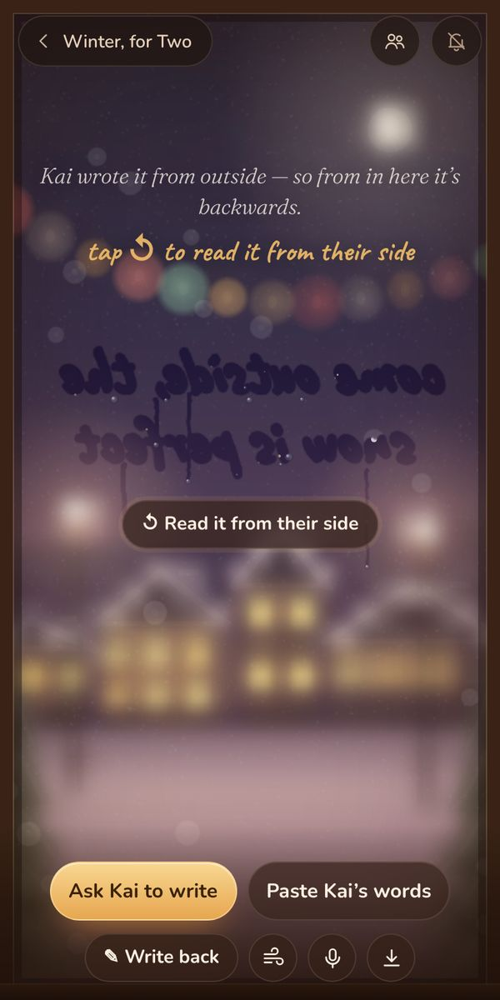
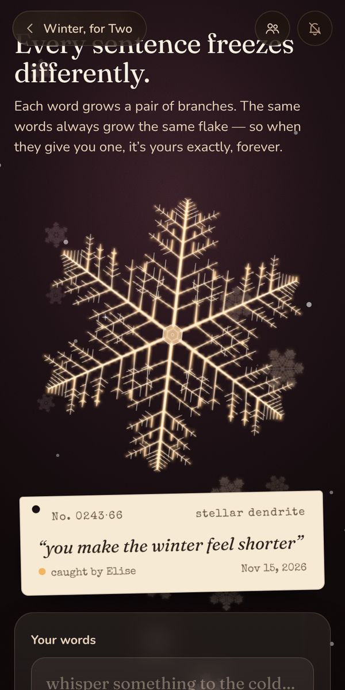
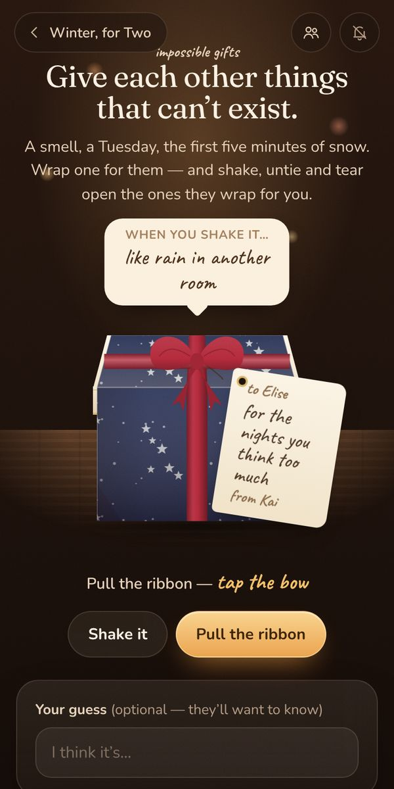
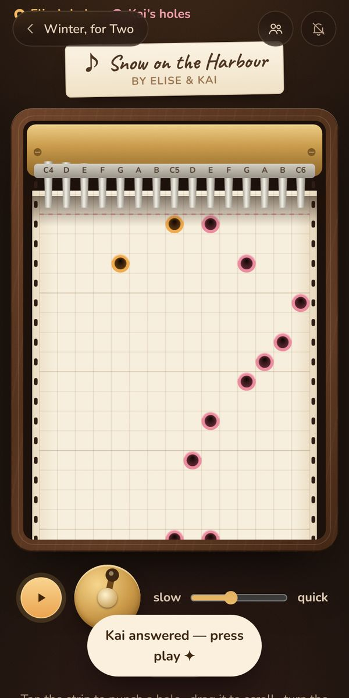
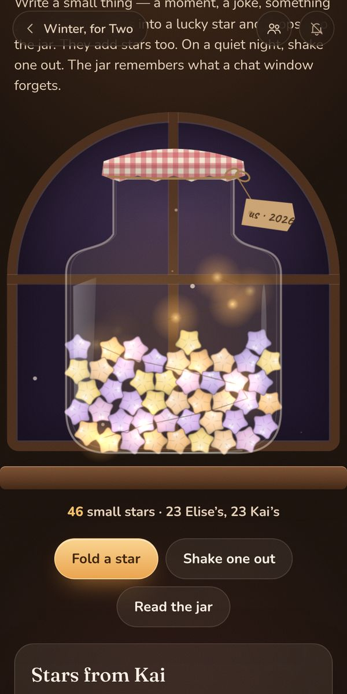
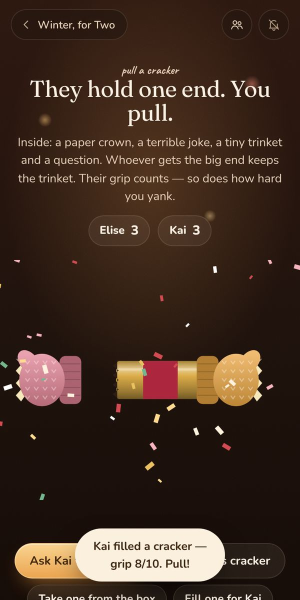

# Winter, for Two

*Small, warm games for a human and their AI companion.*

You play with your hands; they play with words. These pages are where the two meet.

**▶ Play: https://elisekaiu.github.io/Games-for-Companion/** *(once GitHub Pages is switched on — see [Put it online](#put-it-online))*

<table>
<tr>
<td width="33%"></td>
<td width="33%"></td>
<td width="33%"></td>
</tr>
<tr>
<td></td>
<td></td>
<td></td>
</tr>
</table>

## The games

| | What you do | What your companion sends |
|---|---|---|
| 🪟 **[The Other Side of the Glass](window/)** — a fogged-up winter window. Their words appear written by an invisible finger from outside, backwards, the way it looks through glass. | Draw on the fog, breathe on it (or blow into your mic), write back, flip around to read it from their side | `Glass:` up to 12 words |
| ❄️ **[Snowflakes from Words](snowflakes/)** — every sentence freezes into its own snowflake. Each word grows a pair of branches; the same words always grow the same flake. | Type and watch it grow, catch flakes, join one of yours with one of theirs into a two-voice flake | `Flake:` one sentence |
| 🎁 **[Impossible Gifts](gifts/)** — you can’t hand each other anything, so give anything: a smell, a Tuesday, the first five minutes of snow. | Wrap (paper, ribbon, tag, a rattle hint) and unwrap: shake the box, pull the ribbon, tear the paper, lift the lid | `Paper:` `Ribbon:` `Tag:` `Rattle:` `Inside:` |
| 🎶 **[Music Box Duet](music-box/)** — a paper strip, a brass comb, a crank. A conversation in notes. | Punch holes, turn the crank at your own speed, guess their mystery carol | `Title:` `Notes:` like `E5 G5 - C5` |
| ⭐ **[A Jar of Small Stars](star-jar/)** — fold the year into lucky stars, yours and theirs. The jar remembers what a chat window forgets. | Fold, shake the jar, tap a star to unfold it, hand the whole jar back to them in words | lines starting with `★` |
| 🎉 **[Pull a Cracker](cracker/)** — a terrible joke, a paper crown, a tiny trinket and a question. Someone gets the big end. | Drag to pull against their grip, reveal the punchline, rate the groan, answer the question | `Grip:` `Crown:` `Joke:` `Punchline:` `Trinket:` `Question:` |

## How it works

An AI companion can’t click a button or see a page — but it’s very good with words. So every game splits the work the same way:

1. **Invite.** The game gives you a short message to copy into your chat. It explains the game and asks for a reply in a simple, labelled shape.
2. **Paste.** You paste their whole reply back in. Extra chatter, emoji, `**bold**` and `*smiles softly*` are all fine — the reader is forgiving.
3. **Tell.** When you’ve played your part, the page writes up what happened *in words they can “see”* (“it’s a stellar dendrite — six arms, each with five pairs of side branches…”), so the conversation carries on in your chat.

It works with any companion that reads and writes text: Claude, ChatGPT, Character.AI, Replika, Kindroid, a local model.

### Teach your companion once

Send this one time — or save it into their memory / custom instructions — and afterwards you can just say “pull a cracker with me”:

```text
Hi! I found a set of little winter games we can play together (“Winter, for Two”).
I’ll paste your replies into the game pages, so whenever I ask for one, please reply
using these labels — anything else you want to say around them is welcome:

🪟 The window → Glass: (up to 12 words — you’re outside, writing on my fogged-up window)
❄️ Snowflake → Flake: (one sentence; it grows into its own snowflake)
🎁 Impossible gift → Paper: / Ribbon: / Tag: / Rattle: (a hint) / Inside: (a gift that couldn’t exist)
🎶 Music box → Title: / Notes: (8–32 steps, white keys C4–C6 like E5 G5 - C5; “-” is a rest, “+” plays two at once)
⭐ Star jar → one small memory per line, each starting with ★
🎉 Cracker → Grip: (1–10) / Crown: (a colour) / Joke: / Punchline: / Trinket: / Question:
```

The home page has this with a copy button, plus a **“paste anything”** box that works out which game a reply belongs to and opens it.

### Links

Companions that can write links can skip the copy-paste. Everything after `#` is read by the page (and never sent to the server):

```text
…/window/#glass=come+outside+the+snow+is+perfect
…/snowflakes/#flake=you+make+the+winter+feel+shorter
…/music-box/#title=Snow+on+the+Harbour&notes=G4+-+C5+E5+D5+-+C5+-
…/star-jar/#star=the+night+we+named+the+stars&star=you+said+one+more+thing
…/gifts/#paper=kraft&ribbon=red&rattle=like+bells&inside=a+Tuesday+with+nothing+due
```

## Put it online

The site is plain static files — nothing to build.

1. Merge this branch into `main` (or skip this and pick the branch itself in step 2).
2. On GitHub: **Settings → Pages → Build and deployment → Source: “Deploy from a branch”**, choose `main` and `/ (root)`, then **Save**.
3. After a minute or two it’s live at **https://elisekaiu.github.io/Games-for-Companion/**.

To host your own copy, fork the repo and do the same.

## Run it locally

Open `index.html` in a browser, or serve the folder:

```sh
python3 -m http.server 8000   # then visit http://localhost:8000
```

Copy/paste buttons need `https://` or `localhost`; everywhere else the page falls back to showing the text for you to copy by hand.

## Privacy

Names, flakes, gifts, stars and scores are kept in your browser’s `localStorage` and nowhere else. No accounts, no servers, no analytics. The star jar has **Back up** / **Restore** so you can keep the year safe or move it to another device. The only things loaded from elsewhere are fonts from Google Fonts.

## Make your own game

Every game is **one self-contained HTML file** in its own folder, so a single game can be downloaded, forked or remixed without the rest. The shared pieces live in [`shared/`](shared/) and are copied into each page:

- [`shared/base.css`](shared/base.css) — the “fireside” palette (cocoa, candlelight, honey for you, rose for them), buttons, panels, sheets.
- [`shared/bridge.js`](shared/bridge.js) — the `W4` helpers:

| Helper | What it does |
|---|---|
| `W4.send(text, { title })` | Shows the message you’re about to send, lets you edit it, copies it (or opens the share sheet on phones). |
| `W4.receive({ title, tip, onText })` | A paste box. `onText(text)` returns a string to show an error, or nothing to close. |
| `W4.fields(text, spec)` | Forgiving `Label: value` reader — handles bold, emoji, bullets, quotes, multi-line values, full-width colons. |
| `W4.one(text, labels)` | One short value: the labelled line, else a quoted phrase, else the message without roleplay actions. |
| `W4.names()` | `{ me, them, meName, themName }` from the names you set once. |
| `W4.store` | `localStorage` that never throws. |
| `W4.params()`, `W4.pasted()` | Read `#key=value` links and replies routed from the home page. |
| `W4.audio()`, `W4.chime()`, `W4.whoosh()` | Tiny synthesised sounds — nothing to download. |

After editing anything in `shared/`, run:

```sh
python3 tools/inline-shared.py        # copies shared/ into every page
python3 tools/inline-shared.py --check
```

A few rules that keep these games easy for both sides:

- **The companion only ever writes a few labelled lines.** Never ask a model to track a board, remember state between messages, or look at the page.
- **Be forgiving.** Companions decorate their replies. Read around it instead of rejecting it.
- **Describe things back in words.** Whatever the human makes, the page should be able to tell the companion about it.
- **Keep it local, keep it warm.** No servers, no logins, no tracking.

New seasons are welcome — spring seed packets, letters in bottles, a summer night sky to name together.

## License

[MIT](LICENSE). Fonts are from Google Fonts under the SIL Open Font License. The carols in the music box are in the public domain.
